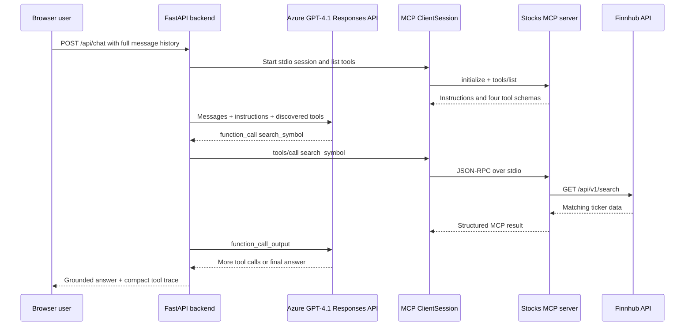

# Market Thread: Finnhub Stock Research over MCP

Market Thread is a browser and Telegram research assistant for US-listed stocks. A user can ask about a company by name, and GPT-4.1 resolves its ticker and retrieves a current quote, company profile, and recent news through an MCP server backed by Finnhub.

The application is intentionally small enough to explain end to end. The browser never receives provider keys and never calls Finnhub directly.

## Project Brief: Dolev Bargig

**Idea / use case:** Help retail investors research a US-listed company using its latest quote, business profile, and recent news without inventing missing market data.

**API documentation:** [Finnhub API documentation](https://finnhub.io/docs/api)

**Endpoints and MCP tools:**

| Finnhub endpoint | MCP tool | User intent |
| --- | --- | --- |
| `GET /api/v1/search` | `search_symbol` | Resolve a company name such as Nvidia to a ticker such as NVDA |
| `GET /api/v1/quote` | `get_stock_quote` | Retrieve the latest price, change, high, low, open, and previous close |
| `GET /api/v1/stock/profile2` | `get_company_profile` | Retrieve company identity, industry, country, exchange, and market cap |
| `GET /api/v1/company-news` | `get_company_news` | Retrieve recent company headlines and summaries |

**Prompt behavior:** Resolve ambiguous company names before requesting data, automatically chain quote/profile/news tools for broad research, disclose missing data and partial failures, and never invent current figures.

**First example request:** `Research Nvidia for me. Include its latest quote, company profile, and important news from the last 7 days.`

**Chat path and status:** UI and Telegram webhook; Done. Live Azure/Finnhub research and all three Telegram demonstrations were verified on October 11, 2026. See the live validation record below.

## Request Flow



The chat backend does not import Finnhub handlers. Every model-selected tool crosses the official MCP stdio boundary through `ClientSession.call_tool()`.

## Project Structure

- `tools_definitions.py` contains the framework-neutral tool names, descriptions, and JSON schemas.
- `tool_handlers.py` validates inputs, calls Finnhub, normalizes responses, and returns structured success/error envelopes.
- `system_prompt.py` defines ticker-resolution, chaining, grounding, and response rules.
- `mcp_server.py` registers the four tools with the official MCP Python SDK and serves them over stdio.
- `mcp_client.py` is the chat backend's request-scoped MCP client.
- `azure_responses.py` calls the exact configured Azure Responses endpoint.
- `chat_service.py` executes the bounded Azure/MCP tool loop.
- `app.py` exposes the FastAPI routes, authenticated Telegram webhook, and same-origin UI.
- `telegram_service.py` provides Telegram authorization, history, deduplication, concurrency control, and Bot API delivery.
- `telegram_webhook.py` manages chat-ID discovery and webhook registration without command-line secrets.
- `static/` contains the browser chat interface.
- `tests/` contains mocked unit/API tests and a real MCP subprocess protocol test.

## Security Model

Secrets belong only in the local `.env` file or process environment. `.env` is excluded by `.gitignore`; `.env.example` contains names and safe placeholders only.

The application never includes keys in:

- Python source code
- Browser JavaScript
- HTTP responses
- Tool traces
- Test fixtures containing real credentials
- Documentation

Any key pasted into chat or another shared system should be rotated before use.

## Setup

Python 3.12 is recommended.

```bash
cd /Users/bargigdolev/StocksMCP
python3 -m venv .venv
.venv/bin/python -m pip install -r requirements.txt
cp .env.example .env
```

Edit `.env` locally and enter rotated credentials:

```dotenv
FINNHUB_API_KEY=your_rotated_finnhub_key
AZURE_OPENAI_API_KEY=your_rotated_azure_key
AZURE_OPENAI_ENDPOINT=https://your-resource.openai.azure.com/openai/v1/responses?api-version=preview
AZURE_OPENAI_MODEL=gpt-4.1
TELEGRAM_BOT_TOKEN=
TELEGRAM_WEBHOOK_SECRET=
TELEGRAM_ALLOWED_CHAT_IDS=
TELEGRAM_PUBLIC_URL=
```

`AZURE_OPENAI_ENDPOINT` is treated as the complete Responses API URL. The backend does not append a path or replace its query string.

## Run the Application

```bash
cd /Users/bargigdolev/StocksMCP
.venv/bin/python -m uvicorn app:app --host 127.0.0.1 --port 8000 --reload
```

Open [http://127.0.0.1:8000](http://127.0.0.1:8000).

The UI and API share one origin. No CORS configuration is required. For Telegram, run one Uvicorn worker without `--reload` so in-memory chat history remains consistent.

## HTTP API

### `GET /api/health`

Reports whether Azure and Finnhub configuration are present. It does not contact either provider and does not return secret values.

### `POST /api/chat`

The endpoint is stateless. Send the complete conversation history with the newest user message last:

```bash
curl -sS http://127.0.0.1:8000/api/chat \
  -H 'Content-Type: application/json' \
  -d '{
    "messages": [
      {
        "role": "user",
        "content": "Research Nvidia. Include its quote, profile, and recent news."
      }
    ]
  }'
```

### `POST /telegram/webhook`

Telegram calls this authenticated route. The endpoint validates `X-Telegram-Bot-Api-Secret-Token` before parsing JSON, acknowledges accepted text updates quickly, and performs the Azure/MCP work as a local background task. Do not call this route manually with a real webhook secret; use the registration helper described below.

The browser response contains the final answer and a compact demonstration trace:

```json
{
  "answer": "...grounded response...",
  "trace": [
    {
      "tool": "search_symbol",
      "arguments": {"query": "Nvidia"},
      "status": "success",
      "summary": "Returned 1 result(s)."
    }
  ]
}
```

## Prompt and Tool Behavior

1. A natural-language company name must be resolved with `search_symbol`; the model must not guess a ticker.
2. Broad research requests chain `get_stock_quote`, `get_company_profile`, and `get_company_news` after resolution.
3. Narrow questions call only the relevant tools.
4. Every tool result has an `ok` field. An `ok: false` result must be explained rather than replaced with an assumption.
5. Search results are capped at 8 candidates and news results at 10 articles to keep model context concise.
6. Tool rounds and total calls are bounded so a malformed model loop cannot run indefinitely.

## Tests

All automated tests avoid live provider traffic:

```bash
cd /Users/bargigdolev/StocksMCP
.venv/bin/python -m unittest discover -s tests -v
.venv/bin/python -m pip check
```

The suite covers:

- Finnhub input validation, rate limits, timeouts, invalid JSON, empty data, and output caps
- Azure authentication/error sanitization and exact endpoint use
- Tool discovery, schema translation, chaining, multiple calls, and `call_id` preservation
- Invalid model arguments, unknown tools, missing final output, and tool-call limits
- FastAPI request validation, health reporting, static files, successful responses, and sanitized failures
- A real MCP subprocess initialization, tool discovery, and structured tool call over stdio
- Telegram webhook authentication before JSON parsing, ignored updates, and background dispatch
- Telegram allowlisting, deduplication, per-chat history, ordering, concurrency, chunking, and transport sanitization
- MCP child-process isolation from Azure and Telegram secrets

## Demo Script

### Successful request

1. Start the application and open the browser UI.
2. Select **Research Nvidia**.
3. Expand the MCP trace beneath the answer.
4. Show `search_symbol` resolving `Nvidia` to `NVDA`.
5. Show the quote, profile, and news calls using the resolved ticker.
6. Ask a follow-up: `Which of those news items is most relevant to the company's core business?`
7. Explain that the browser resends visible history while the backend remains stateless.

### Graceful error

Use the example prompt for `NotARealCompanyXYZ`, or temporarily remove `FINNHUB_API_KEY` from `.env` and restart the backend.

Expected behavior:

- The MCP tool returns an explicit `SYMBOL_NOT_FOUND` or `CONFIGURATION_ERROR` payload.
- GPT-4.1 explains that the requested data is unavailable.
- No ticker, price, profile, or news figure is invented.
- The UI remains usable and exposes the failed tool step in its compact trace.

## Design Decisions

- **MCP is a real boundary:** the FastAPI process starts the MCP server as a subprocess and communicates over stdio.
- **Stateless HTTP:** the browser owns conversation history, making requests easy to inspect and reproduce.
- **Direct Azure HTTP adapter:** the exact challenge endpoint is configurable and no SDK rewrites its path or API-version query.
- **Structured errors:** provider and validation failures remain machine-readable for the model and user-safe for the browser.
- **Same-origin UI:** keys remain server-side, and the demo requires only one local process plus its MCP child process.
- **No investment recommendations:** the assistant presents research facts and cautious synthesis, not personalized financial advice.

## Telegram Setup

Complete these steps only after rotating the Azure and Finnhub credentials. Never paste a bot token or webhook secret into chat, source code, shell arguments, screenshots, or documentation.

### 1. Create the bot

1. Open the official [@BotFather](https://t.me/BotFather) account in Telegram.
2. Send `/newbot` and follow the prompts for a display name and username.
3. Put the returned token directly into `TELEGRAM_BOT_TOKEN` inside the ignored local `.env`.
4. Send the new bot a `/start` message so Telegram creates an update that contains your chat ID.

### 2. Generate the webhook secret

Generate a random value locally:

```bash
cd /Users/bargigdolev/StocksMCP
.venv/bin/python -c 'import secrets; print(secrets.token_urlsafe(32))'
```

Put that value directly into `TELEGRAM_WEBHOOK_SECRET` in `.env`. Do not send it through chat.

### 3. Discover and allow your chat ID

This command reads the bot token from `.env`; it does not place the token in shell history or process arguments:

```bash
cd /Users/bargigdolev/StocksMCP
.venv/bin/python telegram_webhook.py discover-chat-id
```

Put your numeric result into `TELEGRAM_ALLOWED_CHAT_IDS`. Multiple approved IDs may be comma-separated. The bot denies all chats while this setting is empty.

If no ID is returned, send the bot another message and retry. `getUpdates` cannot discover IDs while a webhook is active; delete the old webhook first if needed.

### 4. Start the backend and ngrok

Run exactly one application worker:

```bash
cd /Users/bargigdolev/StocksMCP
.venv/bin/python -m uvicorn app:app --host 127.0.0.1 --port 8000 --workers 1
```

In another terminal, start an HTTPS tunnel:

```bash
ngrok http 8000
```

Copy only the public HTTPS base URL shown by ngrok into `TELEGRAM_PUBLIC_URL` in `.env`, then restart Uvicorn so it reloads the updated configuration.

### 5. Register and verify the webhook

The helper reads the bot token, webhook secret, allowlist, and public URL from `.env`:

```bash
cd /Users/bargigdolev/StocksMCP
.venv/bin/python telegram_webhook.py set
.venv/bin/python telegram_webhook.py info
```

`info` should show the ngrok webhook URL, zero or a small pending update count, and `has_last_error=false`.

### 6. Test the complete flow

Send the bot:

```text
Research Nvidia. Include its latest quote, company profile, and important news from the last 7 days.
```

Then ask a follow-up:

```text
Which of those news items is most relevant to the company's core business?
```

The second message uses the bounded per-chat history retained by the FastAPI process. Every research turn still crosses MCP stdio before reaching Finnhub.

For the graceful-error demo, send:

```text
Find the ticker and current price for NotARealCompanyXYZ.
```

The bot should explain that no matching symbol or data was found rather than inventing a ticker or price.

### 7. Delete or replace the webhook

When the demo ends:

```bash
cd /Users/bargigdolev/StocksMCP
.venv/bin/python telegram_webhook.py delete --drop-pending
```

ngrok URLs usually change when restarted. Update `TELEGRAM_PUBLIC_URL`, restart Uvicorn, and run `set` again whenever the public URL changes.

## Live Validation Record — October 11, 2026

The existing implementation was reused without rebuilding components. Validation followed `GO_LIVE_GUIDE.md` in order, using the existing Python 3.14.6 virtual environment (3.12 remains the recommended version).

| Check | Observed result |
| --- | --- |
| Environment and automated checks | Dependencies installed; compilation succeeded; all 48 tests passed; `pip check` reported no broken requirements. |
| Configuration | Required provider and Telegram settings and chat allowlist present; local `.env` restricted to mode `600` and excluded from Git. |
| Local browser backend | Used the guide's HTTP alternative, `POST /api/chat`, with “What is Nvidia latest stock price and daily percentage change?” The live response resolved NVDA and returned $229.28 and -0.52%; its trace showed successful `search_symbol` and `get_stock_quote` calls. These are observed demo values, not current-price guarantees. |
| Health and runtime | `/api/health` reported `ready`, all three providers configured, and `gpt-4.1`. Uvicorn ran with one worker. |
| Tunnel and webhook | ngrok exposed port 8000 over HTTPS; the local public URL matched the tunnel; Uvicorn was restarted; the helper registered the webhook with its secret. Final webhook info showed zero pending updates and no last error. |
| Successful Telegram request | Sent “Research Nvidia. Include its latest quote, company profile, and important news from the last 7 days.” The user supplied the delivered bot reply: NVDA quote, company profile, linked recent news, and a research-only disclaimer. Uvicorn recorded a successful webhook request. |
| Follow-up Telegram request | In the same conversation, sent “Which of those news items is most relevant to the company's core business?” The delivered reply referred to a specific article and link from the preceding answer, demonstrating retained conversation context. |
| Graceful-error Telegram request | Sent “Find the ticker and current price for NotARealCompanyXYZ.” The delivered Hebrew reply reported no matching symbol in Finnhub and requested a real company name or ticker; it invented neither ticker nor price. |

Telegram replies were verified from the user's pasted conversation replies. The local HTTP response exposed the tool trace; individual tool traces for Telegram turns were not captured. No credentials, private chat IDs, or raw webhook payloads are recorded here.

### Explaining the Telegram request flow

1. Telegram delivers a message to the public ngrok HTTPS webhook; ngrok forwards it to local FastAPI.
2. FastAPI verifies the webhook secret before parsing JSON. TelegramService checks the chat allowlist and duplicate update ID, then supplies bounded completed chat history.
3. ChatService discovers MCP tool schemas through the official stdio client and sends the conversation and instructions to Azure GPT-4.1.
4. Azure selects tools and arguments. ChatService executes those calls through MCP stdio; the MCP server calls Finnhub and returns structured results to Azure.
5. Azure produces the answer. TelegramService splits long answers, sends the chunks in order through Telegram, and retains the completed turn for follow-ups.

The backend and tunnel must remain running for the live bot. Before stopping them, delete the webhook using the helper so Telegram is not left pointing at an inactive tunnel. A changed tunnel URL requires updating local configuration, restarting Uvicorn, and registering the webhook again.

## Telegram Demo Limitations

- Conversation history, update deduplication, and locks are in memory and disappear on restart.
- Run one Uvicorn worker; multiple workers do not share Telegram history.
- FastAPI background tasks are intentionally lightweight but not durable. A production bot needs a queue and retry ledger.
- The approved-chat allowlist protects Azure and Finnhub quota. Keep it restricted to known chat IDs.
- Telegram answers longer than 4096 characters are split and sent in order.
- A leaked BotFather token must be revoked through BotFather and replaced locally.
